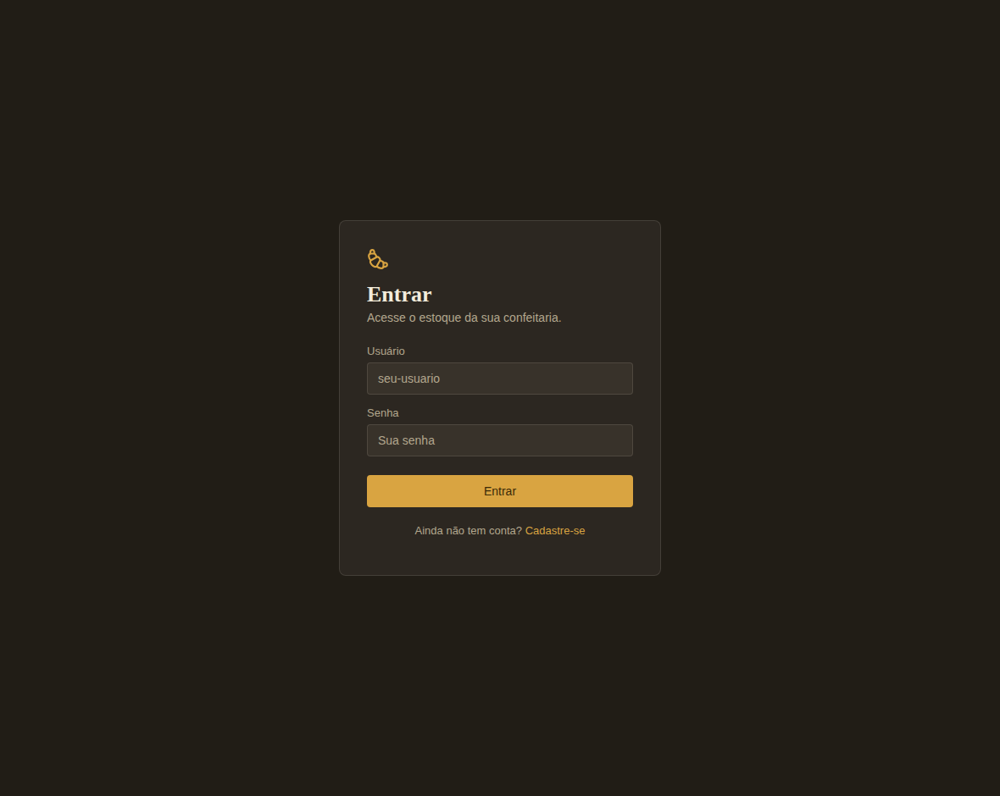
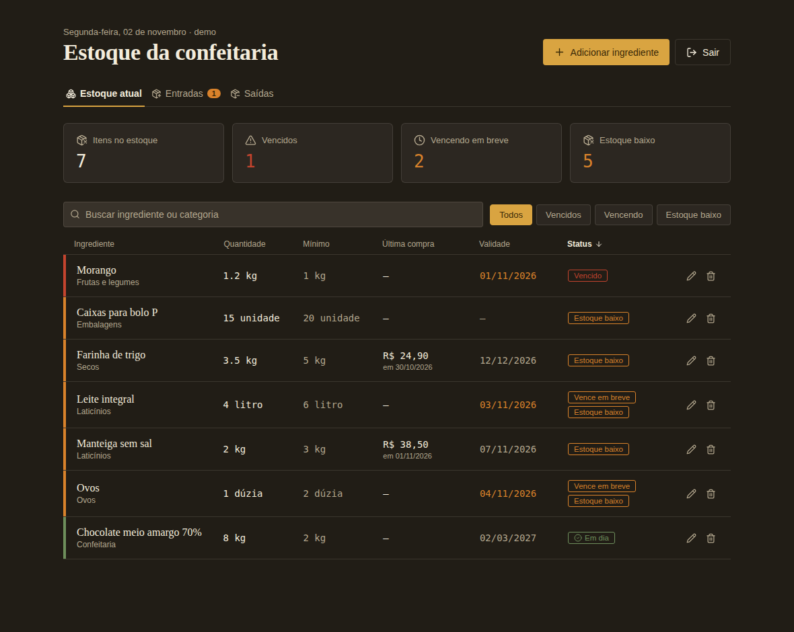
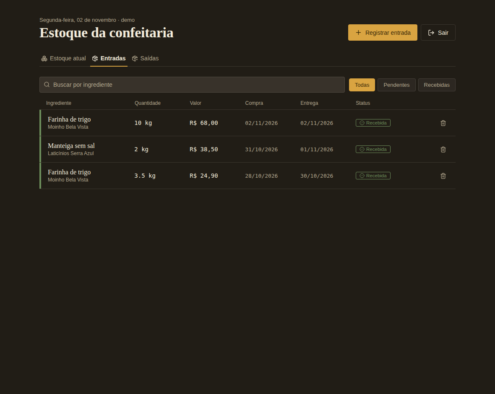
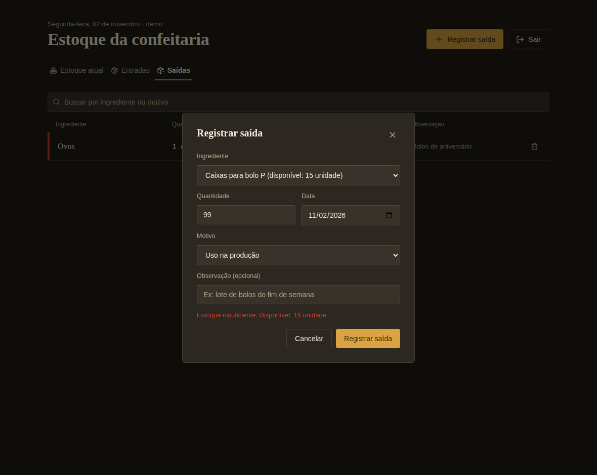
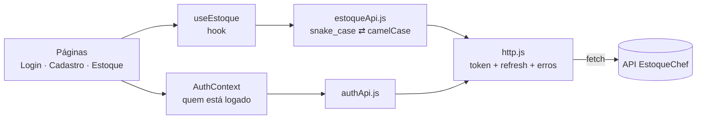
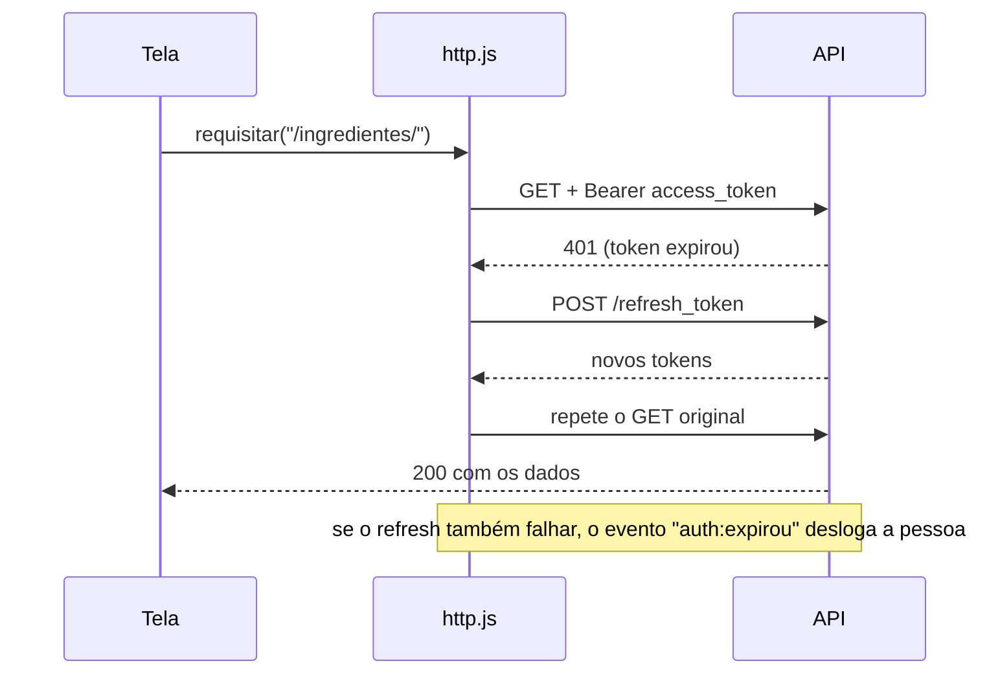

# 🧁 EstoqueChef — Front-end

Interface web do EstoqueChef, um sistema de controle de estoque para restaurantes e confeitarias.
Feita em **React 18 + Vite**, consome a API do repositório **estoquechef-backend** (FastAPI).

| Login | Estoque atual |
|---|---|
|  |  |

## O que este projeto demonstra

| Competência | Onde ver |
|---|---|
| Autenticação JWT com **renovação automática** do token | [`src/api/http.js`](src/api/http.js) |
| Camada de API separada da interface | [`src/api/`](src/api) |
| Hook customizado para dados do servidor | [`src/hooks/useEstoque.js`](src/hooks/useEstoque.js) |
| Rotas protegidas (React Router) e Context API | [`RotaProtegida.jsx`](src/components/RotaProtegida.jsx), [`AuthContext.jsx`](src/context/AuthContext.jsx) |
| Tratamento de erros da API (409, 422, 401) na tela | [`Estoque.jsx`](src/pages/Estoque.jsx) |
| UI própria, sem framework de CSS | [`index.css`](src/index.css) |
| Build multi-stage com Nginx | [`Dockerfile`](Dockerfile) |

## O que o sistema faz

São três telas, todas protegidas por login:

1. **Estoque atual:** ingredientes com quantidade, mínimo, validade, valor da última compra e alertas automáticos
   (vencido, vencendo em até 3 dias, abaixo do mínimo). Busca, filtros e ordenação por qualquer coluna.
2. **Entradas:** histórico de compras. Uma entrada pode ficar **pendente** (o pedido ainda não chegou) e só soma ao
   estoque quando é marcada como recebida.
3. **Saídas:** uso na produção, venda direta, perda ou ajuste. Se a quantidade passar do saldo, a tela mostra o erro.

| Entrada recebida atualiza o estoque | Saída acima do saldo é recusada |
|---|---|
|  |  |

> **Ideia central:** o saldo nunca é editado direto. Ele é consequência de entradas recebidas e saídas, como num
> livro-caixa. Por isso, ao editar um ingrediente, o campo de quantidade fica bloqueado.
> Quem calcula o saldo é o **backend**; o front só exibe.

## Como funciona por dentro



- **`http.js`** é o único ponto que fala com a rede. Ele envia o token, trata erros e renova a sessão.
- **`estoqueApi.js`** converte o formato da API (`ingrediente_id`) para o do app (`ingredienteId`).
- **`useEstoque`** carrega ingredientes, entradas e saídas e, depois de cada escrita, **recarrega as listas**. Assim a
  tela nunca "inventa" um saldo: ela sempre mostra o que está no banco.
- **`Estoque.jsx`** cuida só de exibição, formulários e mensagens de erro.

### Sessão e renovação do token



Várias requisições que recebem 401 ao mesmo tempo **compartilham uma única renovação**.

## Passo a passo para rodar

Pré-requisitos: **Node 18+** e a API rodando em `http://localhost:8000`.

**1. Suba o backend** (repositório `estoquechef-backend`):

```bash
cd estoquechef-backend
docker compose up --build
docker compose exec api estoquechef seed     # cria o usuário demo / demo123 com dados de exemplo
```

**2. Rode o front:**

```bash
cd estoquechef-frontend
npm install
cp .env.example .env        # ajuste VITE_API_URL se a API estiver em outro endereço
npm run dev
```

**3. Abra** http://localhost:5173 e entre com **demo / demo123** (ou crie uma conta em *Cadastre-se*).

### Tour de 2 minutos

1. Em **Estoque atual**, veja os alertas: o morango está vencido, o leite e os ovos vencem em breve.
2. Vá em **Entradas**: há um pedido de farinha **pendente**. Clique no ✓ para marcá-lo como recebido.
3. Volte ao **Estoque atual**: a farinha foi de 3,5 kg para 13,5 kg e o alerta de estoque baixo sumiu.
4. Em **Saídas**, tente retirar 99 unidades de um item: a API responde 409 e a tela mostra o saldo disponível.
5. Tente **editar** um ingrediente: o campo de quantidade está bloqueado, de propósito.

### Rodando com Docker

```bash
docker compose up --build       # front em http://localhost:5173
```

O `Dockerfile` é **multi-stage**: uma etapa instala dependências e roda `npm run build`; a final serve só os arquivos
estáticos com Nginx (sem Node e sem código-fonte). O `nginx.conf` faz rotas como `/login` funcionarem ao recarregar a página.
Como `VITE_API_URL` é "compilada" no JavaScript durante o build, ela entra como `build-arg`, não como variável de runtime.

## Estrutura

```
src/
  api/
    http.js          # fetch com token, refresh automático e tradução de erros
    authApi.js       # login, cadastro, perfil
    estoqueApi.js    # ingredientes, entradas, saídas
  hooks/useEstoque.js
  context/AuthContext.jsx
  components/RotaProtegida.jsx
  pages/             # Login, Cadastro, Estoque
  App.jsx · main.jsx · index.css
```

## Decisões técnicas

| Escolha | Por quê |
|---|---|
| **React + Vite** | Ambiente de dev rápido e build simples (Create React App foi descontinuado). |
| **Context API, sem Redux** | O estado global é pequeno ("quem está logado"). Redux seria complexidade sem ganho. |
| **Hook `useEstoque` + camada `api/`** | A tela não sabe como a rede funciona; se a API mudar, só `src/api/` muda. |
| **Recarregar após cada escrita** | Mais simples e sempre consistente do que recalcular saldo no front. |
| **CSS com variáveis, sem framework** | Paleta de confeitaria centralizada em `index.css`; fácil de ler e de trocar o tema. |
| **Fontes: serifada + monoespaçada nos números** | Dígitos alinhados facilitam comparar quantidades e valores numa tabela. |
| **Barra lateral colorida por severidade** | Mantém a tabela legível mesmo com muitos alertas ao mesmo tempo. |

## Limitações e próximos passos

- Recarrega as três listas a cada escrita (3 requisições a mais). Com muitos dados: paginação ou React Query.
- Tokens no `localStorage`: prático, mas exposto a XSS. Em produção, cookie `HttpOnly` seria mais seguro.
- Sem testes no front ainda. Próximo passo: Vitest + Testing Library, começando por `getFlags` e `diasParaVencer`.
- A regra crítica (saldo) já é testada no backend; o front só antecipa o erro para dar feedback rápido.

## Perguntas que eu me faria numa code review

1. *"Por que validar saldo no front se a regra está no backend?"* Só para dar feedback imediato. A garantia real é o 409 do servidor.
2. *"E se duas pessoas mexerem no estoque ao mesmo tempo?"* O backend trava a linha do ingrediente na transação, e o front recarrega do servidor após escrever.
3. *"Por que `Estoque.jsx` é um componente grande?"* O escopo ainda é pequeno; o próximo passo seria separar as três abas em componentes.
